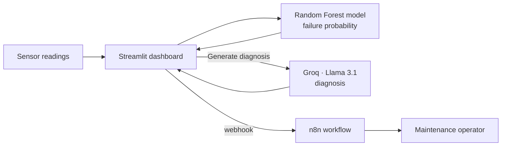
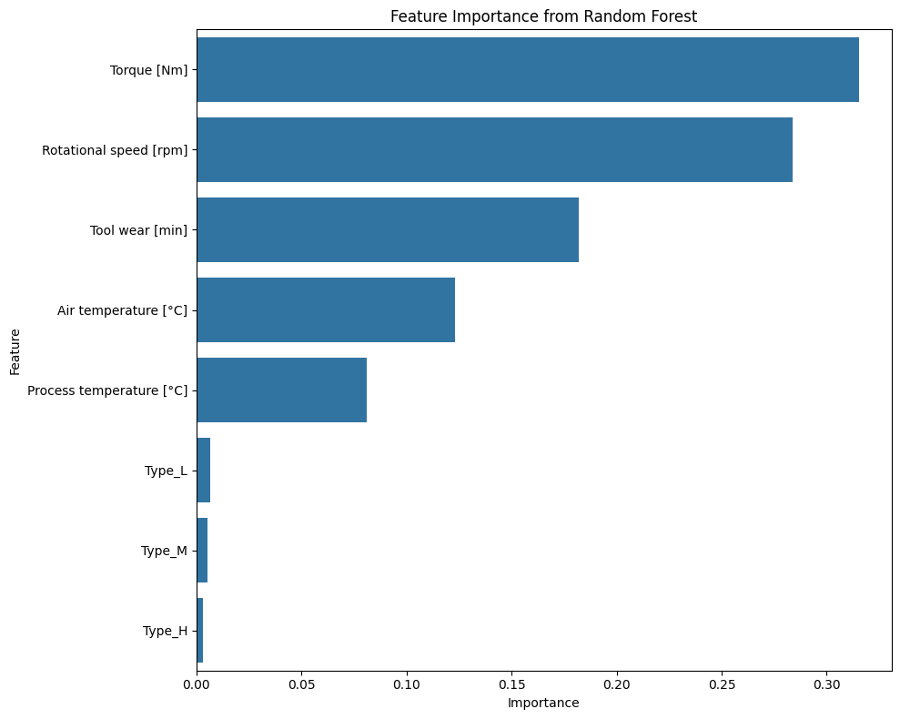
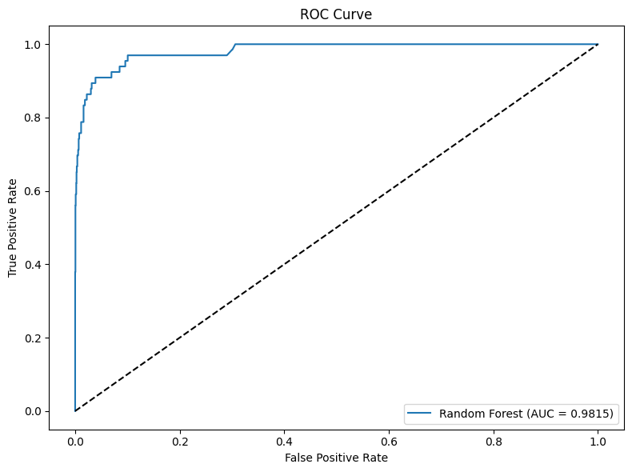
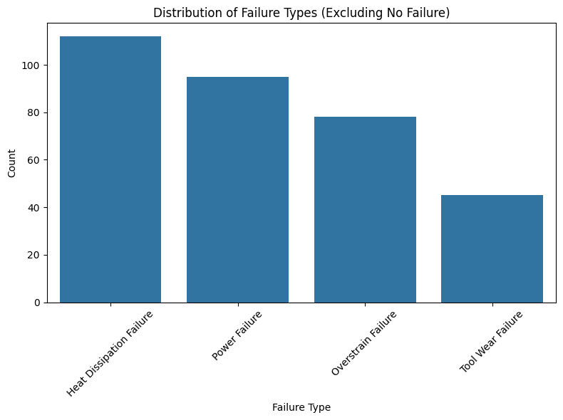
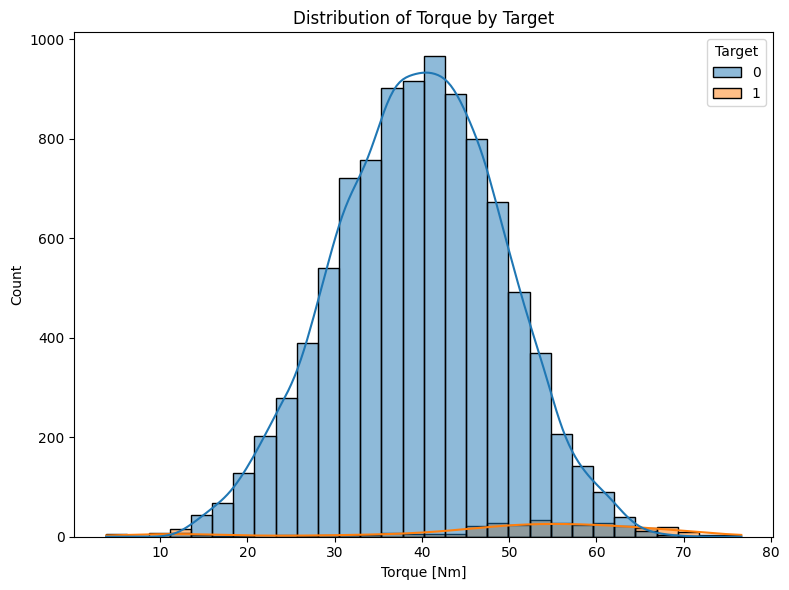

# Predictive Maintenance Alerts

Machine failure prediction with an AI-generated diagnosis and automated operator alerts.

A Streamlit dashboard takes sensor readings from an industrial machine, estimates the probability of failure with a Random Forest model, generates a short diagnosis with an LLM (Llama 3.1 via Groq) and sends the alert to the maintenance operator through an n8n webhook.

## How it works



1. The user enters sensor readings: machine type, air and process temperature, rotational speed, torque and tool wear.
2. The model returns a failure probability and the dashboard shows the status: stable (< 30%), inspection recommended (30–70%) or critical alert (> 70%).
3. "Generate Diagnosis & Notify" sends the readings and the risk score to the LLM, which writes a two-sentence diagnosis.
4. The diagnosis and the alert level are posted to an n8n webhook that notifies the operator.

## Data and model

Dataset: [AI4I 2020 Predictive Maintenance Dataset](https://archive.ics.uci.edu/dataset/601/ai4i+2020+predictive+maintenance+dataset) (S. Matzka, UCI Machine Learning Repository, CC BY 4.0). It is a synthetic dataset with 10,000 records, 6 features, a binary failure label and the failure type.

Preparation:
- Temperatures converted from Kelvin to Celsius.
- 27 rows removed where `Target` and `Failure Type` were inconsistent.
- Failures are only 3.3% of the data, so models were tuned on F1 and class weights were part of the grid search.

Results on the test set (stratified 80/20 split, 5-fold GridSearchCV):

| Model | Accuracy | Precision | Recall | F1 | ROC AUC |
|---|---|---|---|---|---|
| Logistic Regression | 0.963 | 0.458 | 0.576 | 0.510 | 0.923 |
| Decision Tree | 0.984 | 0.766 | 0.742 | 0.754 | 0.928 |
| Random Forest | 0.986 | 0.880 | 0.667 | 0.759 | 0.982 |

The Random Forest had the best F1 and ROC AUC and is the model used in the dashboard. The notebook also includes a multiclass model that predicts the failure type (macro F1 0.65).

| Feature importance | ROC curve |
|---|---|
|  |  |

| Failure types | Torque by target |
|---|---|
|  |  |

## Tech stack

Python, pandas, scikit-learn, matplotlib, seaborn, Streamlit, Groq API (Llama 3.1), n8n.

## Project structure

```
├── app.py                            Streamlit dashboard
├── train.py                          Retrains and saves the model
├── notebooks/
│   └── predictive_maintenance.ipynb  EDA and model comparison
├── models/
│   └── failure_model.pkl             Trained Random Forest pipeline
├── data/
│   └── predictive_maintenance.csv    AI4I 2020 dataset
├── docs/images/                      README figures
├── .streamlit/
│   ├── config.toml                   Theme
│   └── secrets.toml.example          API key template
└── requirements.txt
```

## Running locally

```bash
git clone https://github.com/mireiaacss/predictive-maintenance-alerts.git
cd predictive-maintenance-alerts

python -m venv .venv
source .venv/bin/activate          # Windows: .venv\Scripts\activate
pip install -r requirements.txt
```

Copy the secrets template and add your keys:

```bash
cp .streamlit/secrets.toml.example .streamlit/secrets.toml
```

| Variable | Description |
|---|---|
| `GROQ_API_KEY` | Needed for the AI diagnosis. Free key at [console.groq.com](https://console.groq.com). |
| `N8N_WEBHOOK_URL` | Optional. If not set, no notification is sent. |

Start the app:

```bash
streamlit run app.py
```

The risk prediction works without any keys. To retrain the model:

```bash
python train.py
```

## License

Code under the [MIT License](LICENSE). The dataset belongs to its authors (CC BY 4.0).
